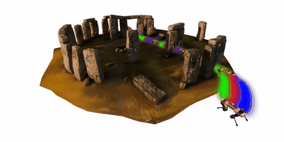

# FOCI: Trajectory Optimization on Gaussian Splats for Gaussian Robots

- **Project page:** [https://rffr.leggedrobotics.com/works/foci/](https://rffr.leggedrobotics.com/works/foci/)

<table align="center" border="1" style="border-collapse: collapse;">
  <tr>
    <th align="center" style="border: 1px solid; padding: 6px;">Static Environment</th>
    <th align="center" style="border: 1px solid; padding: 6px;">Dynamic Environment</th>
  </tr>
  <tr>
    <td style="border: 1px solid; padding: 6px;"></td>
    <td style="border: 1px solid; padding: 6px;"></td>
  </tr>
</table>

FOCI is a novel method to compute orientation aware trajectories for robots using 3D Gaussian Splats to model both the robot and the environment. 


## Authors

- Mario Gomez Andreu\*^1
- Maximum Wilder-Smith\*1
- Victor Klemm1
- Vaishakh Patil1
- Jesus Tordesillas2
- Marco Hutter1

\*Equal contribution  
1 Robotic Systems Lab, ETH Zurich  
2 Comillas Pontifical University

## Citation

When using FOCI, please cite [MADER: Trajectory Planner in Multi-Agent and Dynamic Environments](https://arxiv.org/abs/2010.11061) ([pdf](https://arxiv.org/abs/2010.11061), [video](https://www.youtube.com/watch?v=aoSoiZDfxGE)):

```bibtex
@misc{andreu2025focitrajectoryoptimizationgaussian,
      title={FOCI: Trajectory Optimization on Gaussian Splats}, 
      author={Mario Gomez Andreu and Maximum Wilder-Smith and Victor Klemm and Vaishakh Patil and Jesus Tordesillas and Marco Hutter},
      year={2025},
      eprint={2505.08510},
      archivePrefix={arXiv},
      primaryClass={cs.RO},
      url={https://arxiv.org/abs/2505.08510}
}
```

```bibtex
@misc{andreu2026focitrajectoryoptimizationgaussian,
      title={FOCI: Trajectory Optimization on Gaussian Splats for Gaussian Robots}, 
      author={Mario Gomez Andreu and Carlos MartÍnez Cuenca and Maximum Wilder-Smith and Victor Klemm and Vaishakh Patil and Jesus Tordesillas and Marco Hutter},
      year={2026},
      #eprint={2505.08510},
      #archivePrefix={arXiv},
      #primaryClass={cs.RO},
      #url={https://arxiv.org/abs/2505.08510}
}
```

## Installation
0. Install `git lfs`
1. Clone the repo with `git clone git@github.com:leggedrobotics/foci.git`
2. Obtain a licence for the `MA27` solver from [https://licences.stfc.ac.uk/product/coin-hsl](https://licences.stfc.ac.uk/product/coin-hsl), download the corresponding ZIP file, rename the extracted folder to `coinhsl` and move it to the root directory of this repository.
3. Create the virtual environment with `python3 -m venv venv` and install dependencies with `pip install -r requirements.txt`.
4. Launch any demo file with `python3 -m demos.<demo_name>`.


## Data Attribution
The Gaussian splat file (`demo/data/stonehenge.ply`) included in this repository was generated using processed data from the [Splat-Nav project](https://github.com/chengine/splatnav), which is licensed under the MIT License. 
We acknowledge the authors of Splat-Nav for making their resources available.

The following scenes were obtained from the [Polycam](https://poly.cam) community gallery and are licensed under the [Creative Commons Attribution 4.0 International License (CC BY 4.0)](https://creativecommons.org/licenses/by/4.0/):

| File | Original capture |
|------|------------------|
| `data/barrel.ply` | [Barrel](https://poly.cam/capture/a4b03e8a-f574-47a9-9c6b-4885f1f948cf) | 
| `data/rock.ply` | [Rock on forest path](https://poly.cam/capture/2ebe580f-f0c8-401b-ab91-f1d20d3e35e9) | 
| `data/bonsai.ply` | [new bonsai](https://poly.cam/capture/af057c60-4d80-4bf4-80a0-e623e5e6b257) | 
| `data/coffee_table.ply` | [Coffee Table](https://poly.cam/capture/f258d3c3-5f0f-4e8f-ba77-4cc4662cbdf6) | 
| `data/forest.ply` | [Forest Scan](https://poly.cam/capture/ea94947f-ac7f-4029-b652-95a38a6c1a81) | 

These scenes are third-party assets and are **not** covered by the license of this repository's source code.
We thank the Polycam community members for sharing their captures.